# Bookmark Saver

A Manifest V3 Chrome extension for managing bookmarks from a popup and saving a page's HTML as a bookmark URL. Recommended for those who want a highly customizable HTML document editing experience. Knowledge of basic html or JavaScript or CSS is recommended. 

## Features

- Create bookmarks in folders under the Chrome bookmarks bar.
- Edit and delete bookmarks from the popup.
- Capture the active page's serialized HTML and paste it into the URL field as a `data:text/html` URL.
- Update an HTML bookmark from the active page.
- Adjust popup theme, size, and text size; settings are stored locally.

An HTML snapshot contains the page's serialized DOM (`document.documentElement.outerHTML`). It is not a complete browser archive: it may not preserve runtime state, canvas contents, shadow DOM, or resources that are loaded from external URLs.

## Install from source

1. Download or clone this repository.
2. In Chrome, open `chrome://extensions`.
3. Turn on **Developer mode**.
4. Select **Load unpacked** and choose the folder containing `manifest.json`.
5. Pin **Bookmark Saver** from Chrome's Extensions menu to keep it accessible.

This repository does not currently include Chrome Web Store listing assets or store submission materials; those are outside the scope of this GitHub release.

## Screenshot walkthrough

The following screenshots show the extension being downloaded, loaded as an unpacked Chrome extension, and used to create and update an HTML bookmark.

<figure>
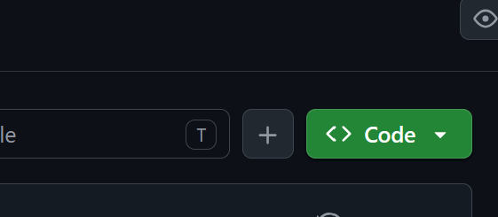
<figcaption>1. Click the green <strong>Code</strong> dropdown menu on the project repository page.</figcaption>
</figure>

<figure>
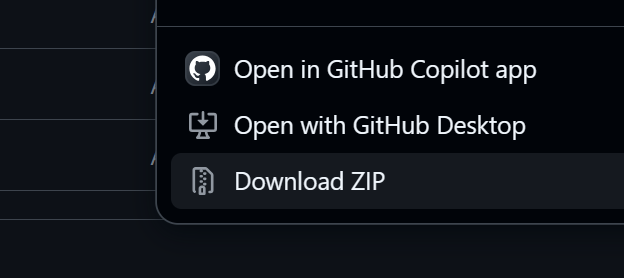
<figcaption>2. Click the <strong>Download ZIP</strong> button to download the Chrome extension.</figcaption>
</figure>

<figure>
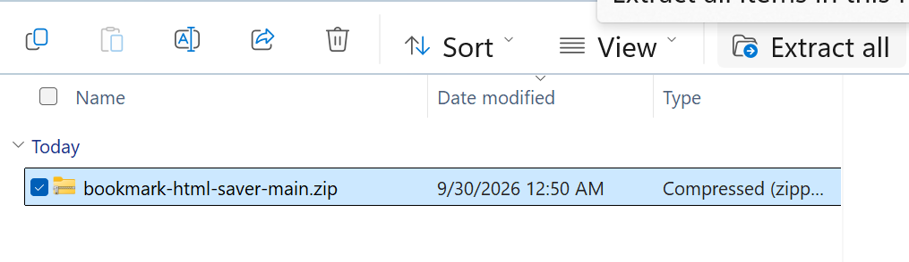
<figcaption>3. Open the <code>.zip</code> folder and extract all its files.</figcaption>
</figure>

<figure>
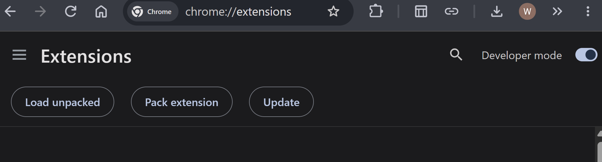
<figcaption>4. Enter <code>chrome://extensions</code>, toggle <strong>Developer mode</strong> on, and click <strong>Load unpacked</strong>.</figcaption>
</figure>

<figure>
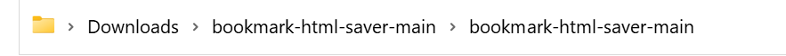
<figcaption>5. Go to your files app and open the extracted Chrome extension folder until you reach the last folder.</figcaption>
</figure>

<figure>
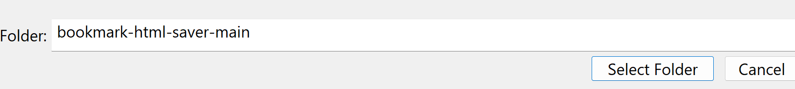
<figcaption>6. Click <strong>Select folder</strong>.</figcaption>
</figure>

<figure>
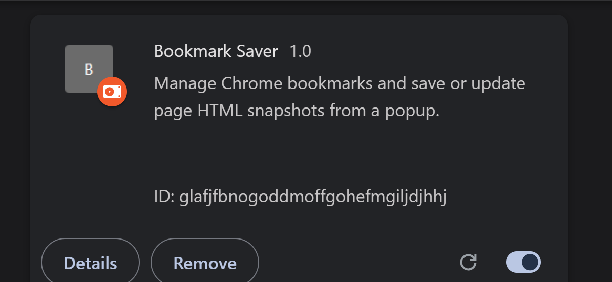
<figcaption>7. You should see the Bookmark Saver extension in <code>chrome://extensions</code>.</figcaption>
</figure>

<figure>
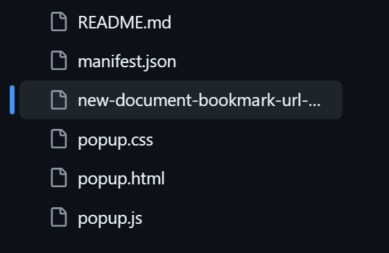
<figcaption>8. Go back to GitHub and click on <code>new-document-bookmark-url-...</code>.</figcaption>
</figure>

<figure>
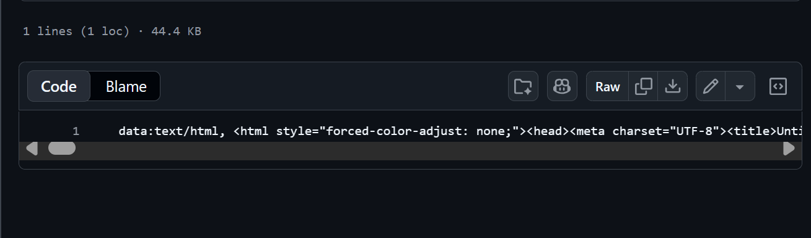
<figcaption>9. Click <strong>copy the raw file</strong>.</figcaption>
</figure>

<figure>
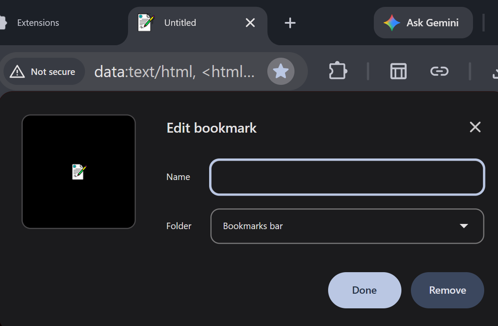
<figcaption>10. Paste the copied URL into a new tab, then save it as a bookmark for later use when you want to create a new document.</figcaption>
</figure>

<figure>
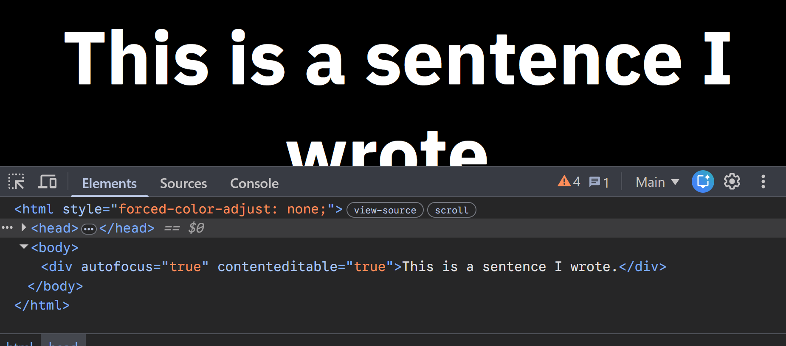
<figcaption>11. After making your first changes to a new document, open Developer Tools with the Chrome shortcut <code>F12</code> or <code>Ctrl+Shift+I</code> on Windows 11, or with Chrome's Developer Tools button. When Developer Tools opens, click the three dots surrounded by <code>&lt;head&gt;</code> and <code>&lt;/head&gt;</code>.</figcaption>
</figure>

<figure>
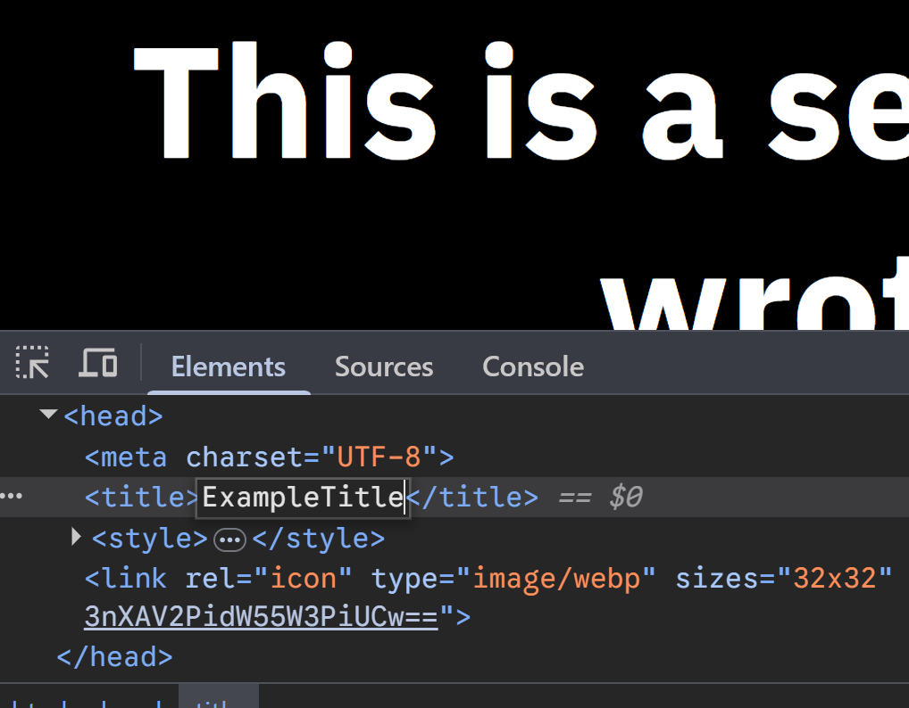
<figcaption>12. Double-click between <code>&lt;title&gt;</code> and <code>&lt;/title&gt;</code> and enter your title. Then press Enter or click nearby to save the title.</figcaption>
</figure>

<figure>
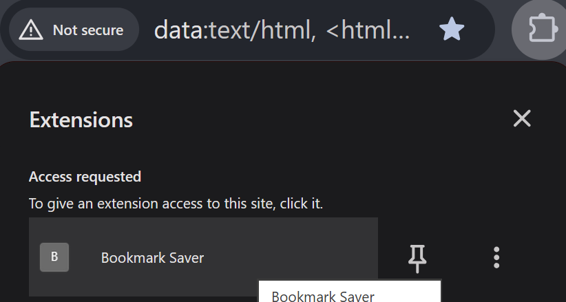
<figcaption>13. Click the <strong>Extensions</strong> button in Chrome. Then click the <strong>Bookmark Saver</strong> extension.</figcaption>
</figure>

<figure>
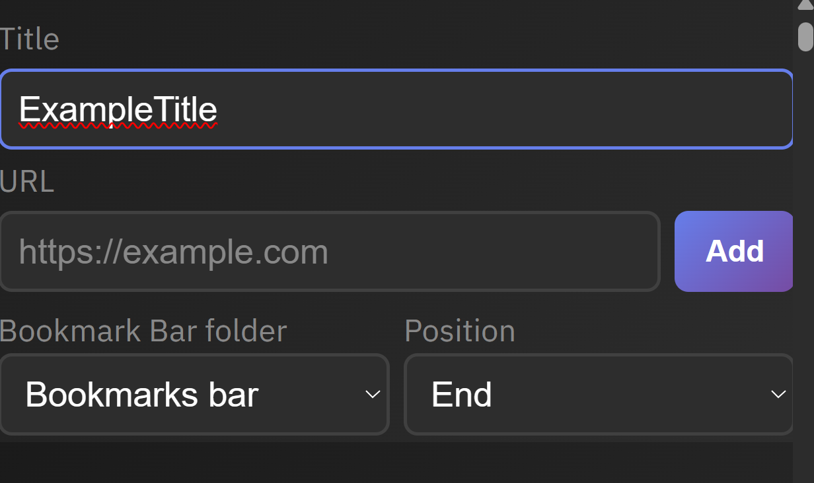
<figcaption>14. Update the bookmark title to match your title. Choose your bookmark location and position.</figcaption>
</figure>

<figure>
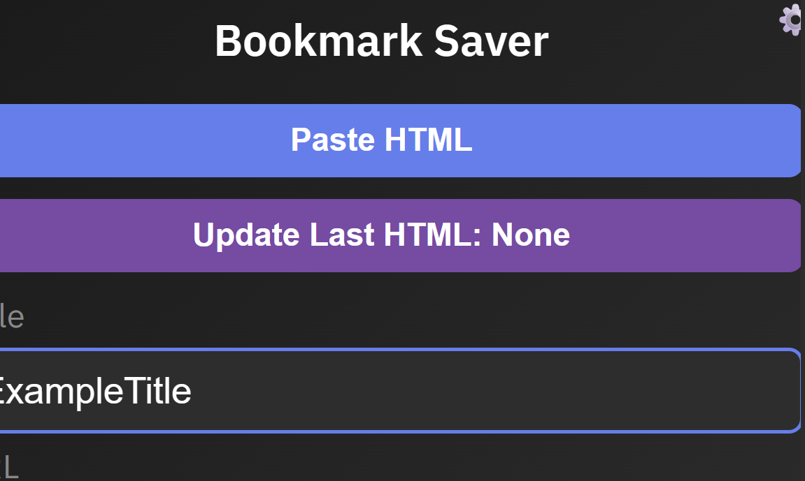
<figcaption>15. Click <strong>Paste HTML</strong> and then click <strong>Add</strong> to add your changes as a new document.</figcaption>
</figure>

<figure>
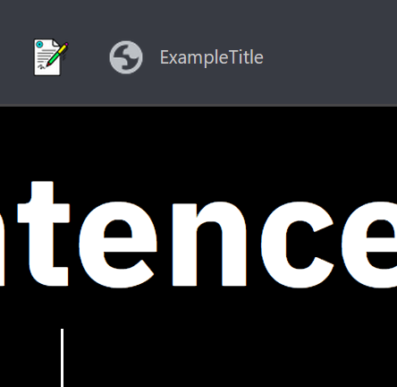
<figcaption>16. If you want to continue editing your document, click the bookmark you previously made and make your changes.</figcaption>
</figure>

<figure>
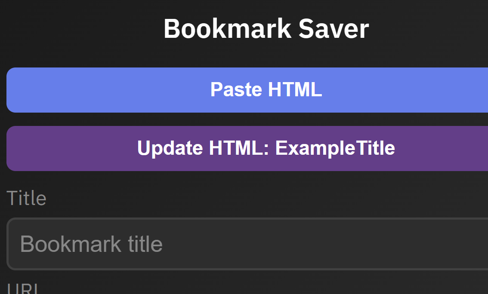
<figcaption>17. Click <strong>Update HTML</strong> to save your changes. <strong>WARNING: Changes are not saved automatically.</strong> If your current tab's title does not match a bookmark, the Update HTML button will instead update the URL of the bookmark that was last saved with this extension with the current page.</figcaption>
</figure>

## Compatibility

This extension is designed for Google Chrome. It has only been tested on Windows 11 with Google Chrome. It may work in other Chromium-based browsers, but compatibility is not guaranteed. Firefox and other non-Chromium browsers are not supported by this version.

## Use

- Enter a title and URL, choose a bookmark-bar folder and position, then select **Add**.
- Edit a bookmark's title or URL in the list and select **Save**. Select **Delete** to remove it.
- Select **Paste HTML** to capture the active page's serialized HTML into the URL field. Review the field, supply a title, and select **Add** to save the snapshot as a bookmark.
- **Update Last HTML** updates a snapshot bookmark with the active page's HTML. The current implementation first looks for a bookmark whose title matches the active page title, then uses the remembered last HTML bookmark as a fallback. See [Known issues and possible fixes](#known-issues-and-possible-fixes) before relying on this behavior.
- Use **Settings** to change appearance and reset preferences.

> **Snapshot testing warning:** The current implementation may corrupt snapshots containing characters such as `#` or `%`; **Update Last HTML** may overwrite the wrong bookmark when titles match; and very large snapshots may be rejected by Chrome. Use a separate Chrome profile and test with non-sensitive pages. See [Known issues and possible fixes](#known-issues-and-possible-fixes) for details.

### Create a blank editable document

1. In Chrome, open the bookmark dialog with `Ctrl+D` (`Command+D` on Mac).
2. Set the bookmark name to `Untitled`, paste the URL below into the URL field, choose a bookmark-bar folder, and save the bookmark.
3. Open the new bookmark to use the blank editable document.

> **WARNING: Changes are not saved automatically.** To save your edits, keep the document tab active, open Bookmark Saver, and click **Update Last HTML**. Wait for the success message before closing the tab or navigating away. Any edits not saved this way may be lost.

> **Formatting warning:** When you copy and paste text into the HTML document, formatting from the source may be retained. To remove the source formatting while pasting, use **Ctrl+Shift+V**. You can also remove formatting later in Developer Tools, opened with **F12** or **Ctrl+Shift+I** on Windows.

```text
data:text/html, <!DOCTYPE html><html style="forced-color-adjust: none;"><head><meta charset="UTF-8"><title>Untitled</title><style>*{text-align: center; color: white !important; background-color: black; font-family: IBM Plex Sans; font-size: 67px; font-weight: 670;} [contenteditable="true"]:focus {outline: none;}</style></head><body><div autofocus="true" contenteditable="true"></div></body></html>
```

This compact URL preserves the editable document and its styling but omits the supplied URL's embedded base64 favicon. Snapshot URLs are not currently encoded; see [Known issues and possible fixes](#known-issues-and-possible-fixes) before using characters such as `#` or `%` in document text.

To use the favicon version instead, open [the full bookmark URL with favicon](new-document-bookmark-url-with-icon.txt), select **Raw** on GitHub, and copy the entire URL into Chrome's bookmark dialog in place of the compact URL above.

The favicon artwork was generated with Gemini, then cropped and recolored in Krita. The exported WebP includes the `sRGB-elle-V2-srgbtrc.icc` color profile, whose embedded notice credits Elle Stone under [CC BY-SA 3.0](https://creativecommons.org/licenses/by-sa/3.0/). This credit applies to the color profile, not the favicon artwork.

## Permissions and access

The extension declares these permissions in `manifest.json`:

- `bookmarks`: read, create, update, and delete bookmarks.
- `storage`: persist popup settings and the ID of the last HTML bookmark locally.
- `activeTab` and `scripting`: read the active page's DOM when capturing a page snapshot.
- `tabs`: locate the active tab and read its title and URL for snapshot operations.
- `debugger`: read the DOM from active `data:` pages, which the regular content-script injection path cannot handle.
- `<all_urls>` host access: request access to pages across sites for page capture.

These permissions are broad, particularly `debugger` and `<all_urls>`. The page-capture feature reads the active page's serialized DOM when you invoke it. Chrome blocks injection on certain protected pages, including Chrome internal pages and the Chrome Web Store. Access to local `file:` pages also requires enabling **Allow access to file URLs** for the extension in Chrome's extension settings. Debugger access can fail if Chrome cannot attach to the page or another debugging session is active.

## Privacy and data handling

- Captured page HTML is placed in a bookmark's URL as a `data:` URL. This can include text or other content visible in the page DOM, potentially including private or account-specific information.
- Bookmarks are managed by Chrome. If Chrome Sync is enabled for bookmarks, snapshot URLs and their embedded HTML may also sync with the user's Google account and other signed-in devices.
- The extension has no network code that sends captured HTML to a developer-operated service. The captured content remains in Chrome-managed bookmarks unless the user syncs, exports, or otherwise shares those bookmarks.
- Treat snapshots as sensitive. Avoid capturing pages containing secrets, private messages, financial information, or other content you would not want stored in a bookmark or synchronized.
- Snapshots may retain scripts, links, or references present in the page markup. Opening a snapshot is not equivalent to opening a sanitized, trusted offline archive.

## Known issues and possible fixes

These are known limitations of the current implementation and should be considered before publishing or relying on snapshots:

- **URL-sensitive characters can corrupt snapshots.** HTML is currently concatenated directly after the `data:text/html,` prefix rather than percent-encoded. Characters such as `#` can be interpreted as a URL fragment, and `%` can begin an invalid or unintended escape. Unicode and other URL-sensitive characters can also be affected. As a result, snapshots containing `#`, `%`, or similar characters may not reopen with their original HTML. A possible fix is to encode the HTML payload when creating the data URL, then test create, update, and reopen behavior in Chrome with `#`, `%`, Unicode, and large content. Until that fix is implemented and verified, assume such snapshots may fail or be corrupted.
- **Title-based update selection can be ambiguous.** The update button searches for a bookmark whose title equals the active page title. Duplicate titles can select the wrong bookmark, and a regular bookmark with that title may be treated as an HTML snapshot. A possible fix is to retain the title-based workflow but only allow a verified HTML snapshot match; report ambiguity when multiple valid matches exist, and use the remembered last HTML bookmark only as a fallback. Verify the bookmark again immediately before changing its URL.
- **Snapshot size is not bounded.** Large pages can produce very long bookmark URLs that Chrome may reject or handle inconsistently. A possible fix is to enforce and document a tested maximum size, with a clear error before attempting to save.
- **Snapshots are not sanitized or complete archives.** The captured value is the current serialized document DOM. It does not guarantee preservation of runtime state, canvas, shadow DOM, or external resources, and page markup can contain active code or remote resource references. Sanitization would change fidelity and should be designed and tested as a separate behavior choice.
- **Permissions are broader than ordinary bookmark management needs.** `<all_urls>` and `debugger` are needed by the current page-capture approach, but they increase access and user-trust concerns. A possible future improvement is to evaluate optional host permissions and a capture design that avoids debugger access, while retaining required `data:` support only if Chrome allows it. Any permission reduction must be tested against the intended page types.
- **Some pages cannot be captured.** Chrome restricts extension injection on protected pages, and debugger attachment can fail. File-page access must be explicitly enabled by the user.
- **The bookmark-bar folder lookup may be locale-dependent.** The implementation has an English-title fallback for the bookmark bar. A future improvement is to rely on stable bookmark tree structure or handle missing folders with a disabled Add action and a clear message.
- **Persisted settings are not validated on load.** Settings stored in extension storage are applied as-is. A future improvement is to validate the theme and clamp width, height, and font size to the same bounds as the settings controls.
- **Bookmark URL validation is limited.** Invalid or unsupported URLs may only be rejected by Chrome's bookmarks API. A possible improvement is to validate and normalize URLs before calling the API while explicitly allowing the intended HTML `data:` URL format.

## AI-generated software and disclaimer

The extension’s files and source code were generated using AI in VS Code and have not been independently audited. AI-generated code may contain errors, security vulnerabilities, or code subject to third-party licenses. This extension is provided “as is,” without warranties of any kind, to the extent permitted by law. Review and test it before use. The maintainer is not responsible for losses or damages arising from its use, except where applicable law does not allow that limitation.

## Manual test checklist

After loading the unpacked extension, test these cases in Chrome:

- Create, edit, refresh, and delete a normal bookmark; verify the chosen folder and beginning/end position.
- Use two bookmarks with the same title and verify the intended one is selected for HTML update.
- Create a page snapshot, reopen its bookmark, and compare the visible content with the source page.
- Test snapshot HTML containing `#`, `%`, Unicode, inline scripts/styles, and a large document; note that encoding-sensitive cases are known to be unreliable in the current version.
- Update an HTML bookmark from another page and verify the expected bookmark changed, not an ordinary bookmark with the same title.
- Try a `data:` page, a Chrome internal page, a Chrome Web Store page, and a `file:` page with file access both disabled and enabled; confirm errors are understandable where capture is blocked.
- Test a large page and confirm Chrome errors are displayed without leaving a misleading update target.
- Change settings, close and reopen the popup, and verify persistence; test reset and minimum/maximum values.
- Try empty fields, malformed URLs, missing folders, and duplicate bookmark titles.

## License

No license is included yet. Unless a license is added, this repository is not explicitly licensed for reuse. Choose and add a license before granting general permission to reuse or redistribute the code.

## General

If you have questions, comments, concerns, or suggestions, feel free to open an issue on the [Issues tab](https://github.com/Wali792/bookmark-html-saver/issues) or contact me via email.
